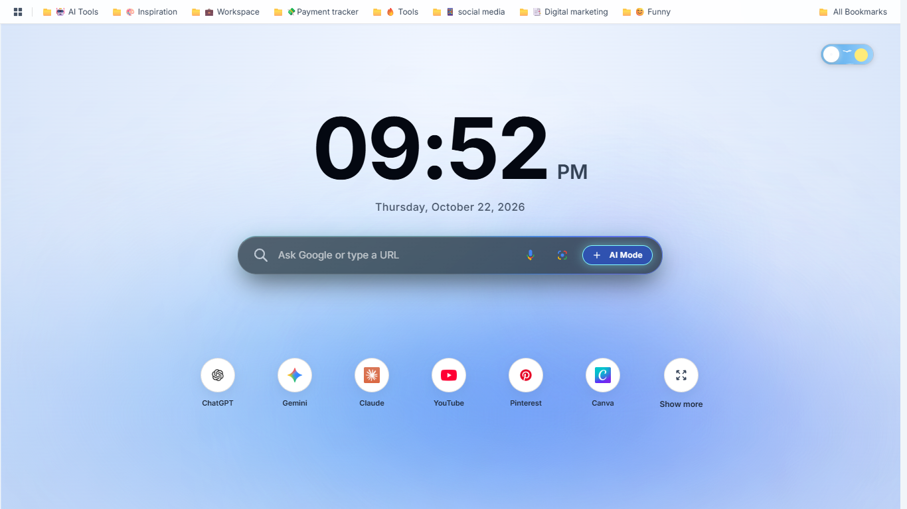
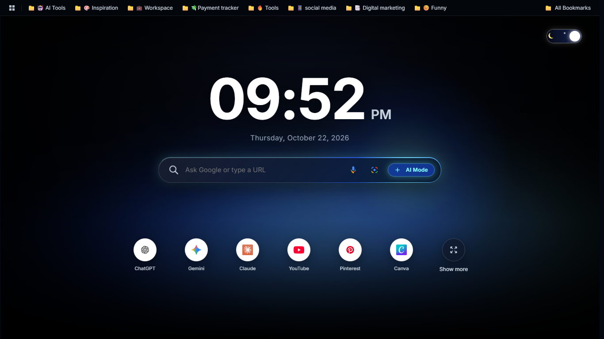

# A Minimalist Chrome Homepage Extension

A minimalist, customizable New Tab experience for Google Chrome with light and dark themes.

## ✨ Preview

| Light Theme | Dark Theme |
|---|---|
|  |  |

## ⬇️ Download

**[Download the latest ZIP](https://github.com/rajvisual/A_minimalist_Chrome_hompage_extension/archive/refs/heads/main.zip)**

The ZIP includes the project files and screenshots. You do not need Git to download it.

> This is currently a developer-mode installation from source, not a Chrome Web Store release.

## 🧩 Install in Google Chrome

1. Click **Download the latest ZIP** above.
2. Open your **Downloads** folder.
3. Right-click the ZIP and choose **Extract All…**.
4. In Chrome, open `chrome://extensions`.
5. Turn on **Developer mode**.
6. Click **Load unpacked**.
7. Select the extracted project folder containing `manifest.json`, `newtab.html`, `app.js`, and `style.css`. Do not select the ZIP file itself.
8. Open a new tab with **Ctrl + T** to view the extension.

## 🌓 Themes

Switch between the light and dark appearances to suit your preference.

## 🏠 New Tab vs. Home button

This extension replaces Chrome's **New Tab** page. Chrome's optional Home button is a separate setting and may not open this extension directly.

## 🔄 Updating

1. Download and extract the latest ZIP.
2. Open `chrome://extensions`.
3. If the extension is already loaded, either update the files in its existing folder and click **Reload**, or remove the old entry and use **Load unpacked** to select the new extracted folder.

## 📁 Project files

- `manifest.json` — Chrome extension configuration
- `newtab.html` — New Tab page structure
- `style.css` — Styles
- `app.js` — Page behavior
- `icons/` — Extension icons
- `screenshots/` — Light and dark theme previews

## 🔒 Note

Review the source code and requested permissions before installing any extension. A successful local installation does not mean the extension has been reviewed or published by the Chrome Web Store.

## 💻 Source code

[Browse the repository on GitHub](https://github.com/rajvisual/A_minimalist_Chrome_hompage_extension)
